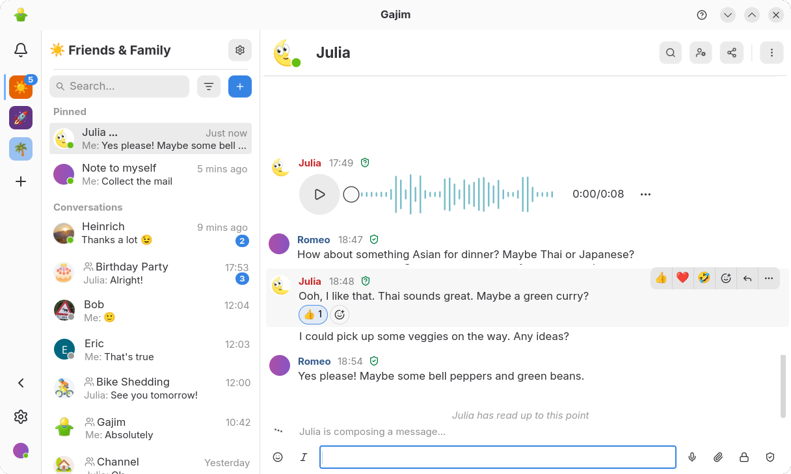
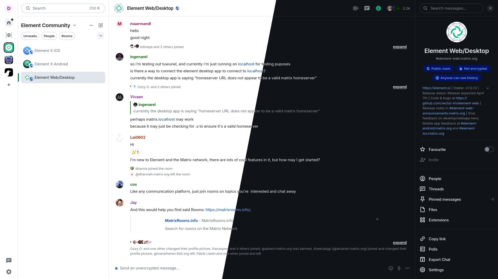

# Analysis and Product Identification

## Glossary

Before I begin, I must define some terms this work uses to reduce ambiguity:

^^__LMEP__^^ - Lightweight Message Exchange Protocol, the name of the protocol I am submitting.
^^__Reference implementations__^^ - Alongside a specification for LMEP, there are also python programs which implement LMEP's minimum requirements to demonstrate its functionality beyond just words. Since LMEP is a client-server protocol, there will be an implementation for the client and an implementation for the server, the word "implementations" referring to both. These may also be referred to as "minimum viable implementation".
^^__Chathome__^^ - An organisational unit hosted by an LMEP server. Each chathome maintains its own collection of chatrooms and members.
^^__Chatroom__^^ - A communication space contained within a chathome. Each chatroom maintains its own message history.
^^__Homeowner__^^ - The owner of a chathome.

## Statement of the Problem

Cloudrain is a cloud storage provider. The CEO of Cloudrain, Marcus Church, and I had a meeting about the issue of communication between different departments, and he believes that the throughput of his company has been hindered by the labyrinth of different messaging protocols and platforms being used by different departments.
He thinks this is because different departments have varying degrees of technical proficiency and use a variety of different hardware.
Some departments rely on older messaging platforms because they use legacy hardware.
Other departments, such as finance, which use modern messaging platforms only within their own departments, still must use older instant messaging protocols to communicate with other departments. Church has asked me to develop an instant messaging protocol for them, which is able to run on older hardware and simultaneously facilitate the needs of modern instant messaging. After meeting with him, these are the main points I have taken away:

* Current protocols which run on legacy hardware do not facilitate modern instant messaging needs, such as pinned messages and replies
* The new instant messaging protocol needs features which would facilitate these needs but needs to be minimal enough to run on legacy hardware. Features would include: replies, permissions management, statuses and presence tracking, and pinned messages.
* The administrator would need a way to create text channels and have permissions to manage them, whilst ordinary employees do not have these permissions.

### Why not upgrade legacy hardware?

Church has pinned down his hesitation to upgrade legacy hardware to four main reasons:

* High replacement costs: Replacing computers across entire departments is expensive, considering that not only workstations have to be replaced but also entire programs and suites of software. This could mean that upgrading hardware might require purchasing new software licences, migrating data and re-training employees.
* Legacy software dependencies: The records and archives department maintains its own in-house archival database software. Upgrading hardware would mean employees within that department would have to spend more time refactoring their code to work on modern hardware instead of archiving company data.
* Operational disruption: Cloudrain performs backups and archives data daily. Upgrading hardware would introduce downtime, which would increase complexity regarding archiving recent data.

## My solution

I will create an instant messaging protocol, which I will name “LMEP” (Lightweight Message Exchange Protocol), where clients can log in with their credentials.
This protocol must be implementable on text-only environments.
If they do not have credentials, they can issue requests to the server to create them. Once they log in, they will be able to access different chatrooms under a single space (named the “chathome”).
They can message others using the chatrooms they have the permissions to access.
There will also be an option to enable and disable TLS (Transport Layer Security) encryption for the server administrator, which can secure messages and data from potential malicious attackers (as plaintext communication is never inherently secure).
Alongside this will also exist the ability to create multiple chathomes under one server, so the heads of different departments can manage their own department’s chathome without managing the chathomes of other departments.  
This protocol will be decentralised. By decentralised, I mean that each server manages their own database of credentials without interaction between servers (known as federation. Federation is not supported by the submitted version of LMEP). This improves the security of the model, since if one LMEP server is compromised, fewer users are affected because credentials are not synchronised between servers.
To accompany a specification for this protocol, I will write a reference implementation so that it is evident that such a protocol works and to assist those who may be interested in implementing LMEP.

## Stakeholders

The stakeholders of LMEP are important because they are the people that are affected by, or have an interest in, it.

### My client

Church is the main stakeholder of the LMEP protocol.
He will be using an LMEP client to communicate with department managers through company-wide or executive chathomes. This is because one aim of the system is to have multiple chathomes under one server, meaning that departments do not interfere with each other when connected to the same server, each department will have its own chathome, and each chathome will be managed by its respective manager of said department (see below under Heads of Departments).
Since he requires a system to ensure that employees can easily access announcements and other important information, I will need to implement a pinned messages feature, where such pinned messages are stored separately from regular messages, so that other LMEP clients can retrieve them by issuing commands (see below under LMEP Model) to the LMEP server.
Church will also need a way of organising messages and business decisions. For this reason, I will also implement a replies feature, where messages can directly reply to other messages so it is clear who is talking to whom.

### Heads of departments

The department managers at Cloudrain are also a stakeholder for this protocol.
They will be using the reference implementation of LMEP to centrally manage the chathome for their department, whilst making sure that only they have the ability to manage chathomes.
Because of this, LMEP will have permissions tracking, where each member of a chathome will be assigned a database entry which manages what they can and cannot do on a chathome, such as deleting messages and renaming chatrooms.
If an LMEP client requests administrative operations from a server, the server will check the client has the sufficient permissions for it, only performing the action if so.
Since there will almost certainly be people with similar names in the same department, a manager of a department will need to distinguish between the two when managing users on a chathome.
For this reason, LMEP will require that each server issue each user within a chathome a Universally Unique Identifier (UUID). A UUID will only be used to identify users globally across a server, it cannot be used as an authentication mechanism, as clients still must authenticate with servers through password. UUIDs are mandated so that even when two or more people have the same name on a server, they show up on the database as distinct entries, rather than the same entry. This will therefore simplify chathome administration.

### Employees

The employees of Cloudrain are a stakeholder for this protocol. They will be using the reference implementation of LMEP to exchange messages. This will especially benefit the Records and Archives department because it means that employees of that department do not have to upgrade their hardware in order to communicate with other departments.
They will be using the reference client implementation of LMEP to organise their messages into different chatrooms to modularise information.
To facilitate this, the reference implementation will have chatroom IDs to identify a chatroom inside of a chathome. This is so that LMEP clients can send messages in a chatroom without messages in one chatroom appearing inside another.
One problem I may run into is the level of technical literacy that employees in different departments may have. For example, employees in the sales department may be less technically inclined than their IT department counterparts. My solution to this is creating an implementation of the LMEP protocol with a simple frontend which abstracts the details of the LMEP protocol from clients so they can focus on sending messages on others.
To make sure that the employees have the necessary skills to navigate using an LMEP client, I will create comprehensive documentation which will be made available on this website. This will go into details about how to set up an LMEP client, but also the more technical details of LMEP for the more technically proficient.
Additionally, the reference client implementation will have an intuitive interface tested with representative users.

## Research

### Current Protocol Observation - Internet Relay Chat

Cloudrain already uses an instant messaging protocol, known as Internet Relay Chat (IRC), which allows employees to communicate within and between departments. IRC is an open protocol[^1], and its specification can be found in [RFC 1459](https://www.rfc-editor.org/info/rfc1459/).

/// caption
<small>WeeChat, a text-interface IRC Client. A popular choice for employees at Cloudrain</small>
///

Having observed IRC's usage, I have come across some benefits and drawbacks:

__Benefits:__

* It is an open protocol
* IRC allows for one-on-one private messages, outside of any channels, which allows messages to be sent and received privately between a sender and recipient.
* IRC is decentralised, meaning that no single entity controls the network, allowing anyone to establish their own servers and channels

__Drawbacks:__

* IRC channels are not encrypted by default. Encryption can be difficult to configure on IRC clients and servers
* IRC has no unique user identifications, which can cause nickname collisions[^2]
* Features which people expect from modern instant messaging protocols, like presence information[^3], replying to messages, and retrieving messages when a user is away

[^1]: Open protocol meaning that it is openly accessible and usable by anyone, and its use is not restricted.
[^2]: Nickname collisions occur when a channel has more than one person with the same nickname, with no way to distinguish between the two
[^3]: This is when a protocol allows clients to share whether a user is available, busy .etc

__My thoughts on IRC:__

IRC is a very mature platform, having existed since 1988. However, it was created with the needs of instant messaging back in 1988 in mind, which means that it lacks a lot of features people used to modern instant messaging would want from it. Whilst IRCv3 improves upon the original RFC 1459 specification greatly, the features that it adds are still not enough to facilitate modern instant messaging. For starters, IRCv3 still permits users to start on plaintext communication, then "upgrade" to a secure TLS connection. Servers do not enforce usage of TLS either, so messages are still sent over the internet in plaintext by default, which is a security nightmare as anyone with basic network monitoring tools can see what messages are sent over IRC.  

### XMPP

After looking at IRC, I decided to research XMPP[^4] to see how it compared with IRC, alongside the benefits and drawbacks of XMPP. Like IRC, XMPP is an open protocol. It is comprised of multiple specifications, most notable of which being [RFC 6121](https://www.rfc-editor.org/info/rfc6121/).

/// caption
<small>Gajim, an implementation of an XMPP client with a graphical frontend</small>
///

[^4]: Which stands for "eXtensible Messaging and Presence Protocol"

After using and observing XMPP, I have come across some benefits and drawbacks:

__Benefits:__

* It is an open protocol.
* XMPP has modern messaging features such as replies, presence informations and retrieves message histories when a user logs on after being away.
* XMPP is extremely flexible. It is a flexible technology that can be used for content syndication, file-sharing, gaming, cloud computing and collaboration, alongside instant messaging.

__Drawbacks:__

* XMPP is very bloated, meaning that it has so many features that using it for persistent group messaging can feel a little overkill.
* XMPP uses XML to encode messages, which adds a lot of server-side and client-side overhead as both the server and client have to encode and decode XML to exchange messages, requests and responses. This can cause noticeable performance issues and can consume a lot of bandwidth.
* XMPP, by design, relies on extensions for most of its functionality. Most of XMPP's functionality comes from extensions, and managing extensions can be quite difficult.

__My thoughts on XMPP:__

XMPP is an excellent protocol, having existed since 1999. Although it might be old by internet standards, its features line up with what people would expect from modern instant protocols. However, the main issue of XMPP is just how many features are in XMPP. It has so many features that users report it feeling more like a general purpose protocol that just so happens to include instant messaging as one of its features. Additionally, it can be quite difficult to set up chatrooms with the purpose of persistent group messaging. More generally, XMPP is quite hard to configure, with specialised technical expertise being required to set up a federated XMPP server.

### Matrix

I also researched the Matrix protocol to see how it compared with IRC and XMPP. Like XMPP, it is an open standard, and it is a federated communication protocol for real-time communication. Its specification found on [the Matrix website](https://spec.matrix.org/latest/).

/// caption
Element web, a web implementation of the Matrix protocol
///

__Benefits:__

* Matrix is an open standard. Matrix publishes its protocol specification and defines APIs for clients, homeservers and other applications, which lets independent implementation co-exist and interoperate without using the same application.
* Matrix has detailed room permissions, allowing different users to have different permissions and power levels for actions such as sending messages and changing room configurations.
* Matrix is decentralised and federated, which means that organisations can operate their own servers whilst communicating with users on other servers.

__Drawbacks:__

* Matrix has a large implementation complexity. It defines several APIs and a broad event-based architecture, rather than only a small set of messaging commands.
* Matrix uses HTTP and structured JSON to format and send messages. This may introduce complexity and overhead for both the client and the server.
* Data is replicated across Matrix servers. Servers participating in a chatroom keep local copies of its history and synchronise those copies, so messages may exist on multiple independently operated servers, which can complicate data deletion and confidentiality.

__My thoughts on Matrix:__

Matrix is another excellent protocol which does a lot of the things that LMEP is trying to achieve. However, Matrix is a very complex protocol which can be difficult to create an implementation of and use. Additionally, implementing a Matrix server also requires a server implementation of HTTP, which means that a server administrator would have to manage a HTTP server alongside a Matrix server. For the purposes of simple text and binary transfer, it is not only complicated to set up but Matrix implementation also have performance issues on older hardware, which can be a problem for Cloudrain employees.

## Proposed Minimum Features

These are the features that I concluded I must have in the LMEP specification (and therefore my reference implementations of the client and server) after doing research, as well as features that need to be included for LMEP to fulfill its purpose

### Security Features

* An LMEP server exposed to the public internet MUST support TLS[^5]. Consequently, these servers MUST block any attempt by clients to connect via plaintext. LMEP servers SHOULD use TLS v1.3[^6], with TLS v1.2[^7] as the minimum supported version. However, TLS will be optional for communications over a private network and for localhost development and testing.
* Users must create credentials with an LMEP server, if it is the first time that they are doing so. Credentials consist of a username and password. When the user creates these credentials, the LMEP server must store these credentials as a database entry, and assign a UUIDv4[^8] number to them so that users, even with the same username, can be distinguished from each other users.
* The LMEP server must store the permissions a user has on a chathome, which must only be changed by the homeowner.
* When a user creates credentials, they MUST send the password over the encrypted TLS channel, and the LMEP server must first hash the password before storing it in its database with a slow password hashing algorithm[^9]. Then, whenever the user logs in, the server hashes the password attempt and checks it against the stored password hash, only permitting to user to log in if the hashes match.

[^5]: Transport Layer Security, a cybersecurity algorithm that encrypts network traffic and ensures that a server is who it says it is.
[^6]: Specified in [RFC 8446](https://www.rfc-editor.org/info/rfc8446/)
[^7]: Specified in [RFC 5246](https://www.rfc-editor.org/info/rfc5246/)
[^8]: Specified in [Section 5.4 of RFC 9562](https://www.rfc-editor.org/info/rfc9562/#section-5.4)
[^9]: Preferably Argon2id or scrypt, with bcrypt and PBKDF2 as acceptable legacy options

### General Connection Features

* The LMEP server and client must connect over a TCP/IP connection (as opposed to UDP). This is because TCP establishes a connection before transmitting application data using a three-way handshake. It also has error detections and provides mechanisms for orderly connection closure. Overall, TCP is a more appropriate choice than UDP for LMEP.
* All messages (which may be referred to henceforth as message payloads) must be preceded with a 5-byte binary header. The first byte is the message type[^10], and the latter four bytes are the message length in bytes.
* The LMEP server must respond to each response from LMEP clients with a status code, followed by a human-readable phrase which describes the status code, similarly to FTP or HTTP.

[^10]: In the minimum viable implementations, the message type field must always be set to `0x00` indicating that the message payload contains only UTF-8 encoded text. It serves no practical purpose for now but has been reserved for additional payload types. Support for these additional payload types, such as binary media, may be introduced in future versions of LMEP, but this is beyond the scope of LMEP in its submitted NEA form.

### Structural Features

* The LMEP client and server must be aware of the hierarchial organisation system, which is: servers -> chathomes -> chatrooms. Messages must be identifiable on an LMEP server in the following format: `chathome-#chatroom-messageNumber` with the first message of a chatroom having a message number of 0. Within a chathome, messages must be identified simply as `#chatroom-messageNumber`
* The LMEP client, once the user is in a chathome, must be able to query the server for available chatrooms within the chathome. The LMEP client must also be able to query the LMEP server for general information such as server uptime and its welcome message (the message issued to clients upon logging in)
* The LMEP server MUST store the message history of each chatroom so that LMEP clients can retrieve them when a user logs back in after being offline for any period of time
* The LMEP server MUST store presence information. The server should be the authoritative source of a user's presence information, storing it in the user's database entry, which the user changes through their LMEP client, which issues a request to the server to change this information.

## Advanced features

These features are extended requirements - features which improve usability, functionality and/or security but are not strictly necessary for the minimum viable implementation.

* LMEP clients could have end-to-end encryption, where each client has keys to encrypt and decrypt messages. Only clients would be able to decrypt messages, so messages are stored on the server as ciphertext, protecting message contents if a server is compromised. This would also require forward secrecy too, which is protecting past messages from future compromises, which could be implemented by generating new keys based off existing agreed upon keys.
* LMEP clients could send media as well as text. Messages with media would generally be distinguished from messages with text because they would have different message types. To conserve server resources, the owner of a chathome could also set limitations on how big each file can be and the total amount of storage files can use up
* LMEP clients could have voice chatrooms as well as text chatrooms, which operate on different ports from the text chatrooms and use UDP instead of TCP, which could be useful for conferencing at Cloudrain.

Again, these features are not strictly necessary for the minimum viable implementation. The provided reference implementations for LMEP will not include these advanced features due to constraints on time.
